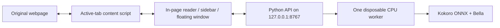

# Speechify

A local, private reading companion for your Mac. Bella reads any webpage aloud
while sentence and word highlights follow the original text on the page. Speech is
generated on your own computer. There is no account, subscription, hosted API or
telemetry.

It ships as three cooperating parts:

| Part | Folder | What it does |
| --- | --- | --- |
| Speech companion | `backend/` | Python service on loopback that runs the Kokoro ONNX model and returns audio plus word timings |
| Browser extension | `extension/` | Manifest V3 extension for Chrome and other desktop Chromium browsers, with an in-page reader and original-DOM highlights |
| Mac app | `macos/` | SwiftUI app that bundles the companion and extension for installation without developer tools |

## Features

- **Reads the page you are on.** Click the toolbar icon, or press the inline play
  button beside an article, X post, Substack note or comment.
- **Highlights the real text.** Sentence and word highlights are painted with CSS
  Custom Highlights on the original DOM. Website text is never wrapped or replaced,
  so links, selection and layout keep working.
- **Highlights follow the audio.** Word timings come from the model's phoneme
  durations mapped back to original character offsets, not from an estimated
  words-per-minute animation. Numbers that are expanded for speech stay attached to
  the digits on the page.
- **Keeps your place.** Pause, resume, seek, click a sentence to jump, step between
  paragraphs, change speed mid-sentence, and save local bookmarks.
- **Three local voices.** Bella is the default; Heart and Nicole are included, each
  with a preview.
- **Works offline after setup.** Roughly 142 MB of verified voice files are
  downloaded once. Nothing you read leaves your machine.
- **Stays small.** One inference worker, two CPU threads, short text chunks, a
  bounded in-memory audio cache, and a worker that unloads after three idle minutes.

## How it works



The extension captures visible text from the active tab, splits it into short
sentence-aware chunks, and asks the companion to synthesize one chunk at a time
with one chunk prefetched. The companion returns WAV audio and word intervals in
UTF-16 code units, which the extension maps straight onto DOM ranges. Requests
are authenticated with a locally generated pairing key and accepted only from
extension origins. See [docs/architecture.md](docs/architecture.md) for the
details and limits.

## Requirements

- Apple Silicon Mac running macOS 14 or later. The source build also runs on
  Intel Macs and Linux for the backend and extension; the Mac app is arm64 only.
- A current desktop Chromium browser with Manifest V3 and unpacked-extension
  support. Chrome 116 is the manifest minimum. Chrome and Comet have passed the
  core reading checks; see [docs/browser-acceptance.md](docs/browser-acceptance.md).
- For building from source: [uv](https://docs.astral.sh/uv/), Python 3.12 (uv
  installs it), Node 22 LTS (see `.nvmrc`), and Xcode command-line tools for the
  Mac app.

Mobile browsers and Safari are out of scope for this version.

## Quick start

### Option A: the standalone Mac app

1. Build the installer with `make installer`, or use a DMG someone built for you.
   The DMG lands in `.data/releases/`.
2. Drag **Speechify** into Applications and open it.
3. Choose **Prepare this Mac** to download and verify the voice files. If you
   already ran the source version, **Import previous setup** copies its models,
   preferences and pairing key instead.
4. Follow **Browser setup** inside the app. It points you at the stable unpacked
   extension folder and walks through Chrome's Developer mode and **Load unpacked**.

The installed app carries its own Python runtime, ONNX Runtime, phonemizer and
prebuilt extension. It needs no Python, Node, uv, Homebrew, Xcode or Terminal.
User data lives in `~/Library/Application Support/Speechify`. Quitting the app
stops the reader it started. No login item or background service is installed.
Full notes are in [docs/macos-app.md](docs/macos-app.md).

### Option B: from source

```bash
git clone <your-remote-url> Speechify && cd Speechify
make setup
```

`make setup` creates the isolated backend environment, downloads and verifies the
voice files, installs locked npm dependencies and builds both extension variants.
Then:

1. Run `make start` (or double-click **Start Speechify.command**). The companion
   starts in the background and the pairing key is copied to your clipboard.
2. In your browser, open the Extensions page, enable **Developer mode**, choose
   **Load unpacked**, and pick one folder:
   - `extension/dist` for browsers with the Side Panel API (Chrome, Edge).
   - `extension/dist-portable` for Comet and other Chromium browsers without it.
3. Open an article, click the extension icon, paste the key once, and press Play.
4. Run `make stop` (or **Stop Speechify.command**) when you are done.

Install only one variant per browser profile, and reload it after rebuilding.
To hear copied text without the extension, double-click **Read with Bella.command**.
[docs/browser-setup.md](docs/browser-setup.md) covers browser differences and
exact permission limits.

## Everyday commands

```text
make setup         Install backend deps, download voices, build the extension
make start         Start the companion in the background and copy the key
make stop          Stop this checkout's companion and model worker
make status        Report whether the companion is running
make backend       Run the API in the foreground on 127.0.0.1:8767
make extension     Rebuild extension/dist and extension/dist-portable
make package       Build both extension ZIPs into .data/releases
make preview       Serve the sidebar against a sample article at 127.0.0.1:8768
make check         Lint, format-check, type-check, test and build everything
make macos         Assemble .data/standalone/Speechify.app
make macos-check   Build the Mac app and run its model-free Swift tests
make installer     Build the app and a drag-to-Applications DMG
make app           Open the local standalone build
```

Backend subcommands are also available directly through uv, for example
`uv run --project backend speechify-control status`.

## Project layout

```text
Speechify/
├── backend/                  Python speech companion (uv, FastAPI, kokoro-onnx)
│   ├── src/speechify_backend/  app, worker, alignment, download, control, companion
│   ├── tests/                  pytest suite; runs without model downloads
│   ├── pyproject.toml
│   └── uv.lock
├── extension/                React + TypeScript Manifest V3 extension (esbuild)
│   ├── src/                    background, content script, reader, player, panel
│   ├── public/                 manifest, HTML entry points, icons
│   └── scripts/                build, test and local preview tooling
├── macos/                    SwiftUI app and DesktopCore package with tests
├── scripts/                  Launchers, lifecycle control, freezing and packaging
├── docs/                     Architecture, product principles, setup and validation
├── .github/workflows/        CI for backend, extension and Mac app
├── *.command                 Double-click launchers (symlinks into scripts/)
└── .data/                    Models, key, logs, builds and releases; ignored by Git
```

## Privacy and resource budget

- The companion listens on loopback only and requires the random key stored in
  `.data/backend.key` with mode 0600. Web origins are rejected by CORS.
- The extension requests `activeTab`, `scripting`, `storage`, `contextMenus` and
  the local backend host. It never asks for persistent access to all websites.
- Text, audio, bookmarks and reading position stay on your machine. The service
  does not persist text or audio or write it to logs.
- Requests are capped at 240 characters. The UI prefetches one section and keeps
  at most six in memory. There is no article-wide audio generation.
- One model worker with two inference threads, no GPU, and an idle unload after
  180 seconds. The small HTTP process stays available.

Initial measurements are in [docs/initial-benchmark.md](docs/initial-benchmark.md).

## Development

Work from the repository root. Use uv for Python and npm for the extension; there
is no global pip or root Python environment. Commit `uv.lock` and
`package-lock.json` together with dependency changes.

- After changing Python, restart the backend.
- After changing extension code, run `make extension` and reload the unpacked
  extension. `npm run dev --prefix extension` rebuilds `dist` on save.
- `make check` runs ruff, pytest, prettier, tsc, the extension tests and build, and
  the Swift tests on macOS. CI runs the same checks without model downloads.
- Changes to alignment or the inference path need a real-model smoke test; the
  command is in [docs/development.md](docs/development.md).
- The standalone preview (`make preview` with the backend started using
  `--preview`) exercises the real sidebar and API, but it does not validate Chrome
  permissions or service-worker behavior. Installing an unpacked extension is
  always a manual step.

Product principles live in [docs/product.md](docs/product.md) and agent
conventions in [AGENTS.md](AGENTS.md). Use `codex/` branches and small commits.

## Known limits

- Normal HTML articles, selected text, and inline play on X and Substack posts are
  supported; not every X page layout has been verified. PDF
  viewers, Kindle's rendered book surfaces, cross-origin frames and
  browser-restricted pages are not.
- Dynamic sites that replace their content can invalidate captured ranges;
  recapture the page if highlights stop following.
- Words are phonemized individually to keep exact page offsets, which can change
  pronunciation compared with whole-sentence synthesis.
- Image-only posts are not read; OCR is out of scope.
- The Mac app is signed locally. Notarization for public distribution is a
  separate release step.

## Documentation

- [Architecture](docs/architecture.md)
- [Product direction](docs/product.md)
- [Development guide](docs/development.md)
- [Browser setup and compatibility](docs/browser-setup.md)
- [Installed-browser acceptance](docs/browser-acceptance.md)
- [Mac app](docs/macos-app.md)
- [Validation](docs/validation.md)
- [Initial benchmark](docs/initial-benchmark.md)

## License

Kokoro model weights are Apache-2.0 and `kokoro-onnx` is MIT. This repository
does not include model weights or third-party voice recordings. No license has
been selected for the project's own code yet; treat it as all rights reserved
until one is added.
