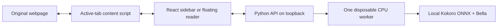

# Architecture

The extension and backend are separate applications with a small JSON API boundary.
The UI owns the reading session; the backend owns synthesis and model lifetime.

## Backend

`config.py` defines paths and the resource budget. `app.py` exposes health, voices,
and speech endpoints using FastAPI. `service.py` schedules a single process worker;
`worker.py` is the only service module that loads ONNX. A disconnected browser does
not release the busy slot until its in-flight inference actually finishes.

The worker loads lazily, uses two inference threads with spinning disabled, and
exits after 180 idle seconds. Exiting the worker releases its model and allocator
memory. Stopping playback prevents new browser requests; an already-running small
chunk finishes. This is bounded work, not immediate interruption of an ONNX call.
These are resource settings, not hard system-wide CPU or RAM quotas.

`download.py` downloads two files from the upstream kokoro-onnx release and verifies
published SHA-256 digests. `cli.py` preserves the clipboard-reading workflow.
The local HTTP service is not a cloud service or a login daemon. `control.py`
provides idempotent background Start/Stop. A held OS lock records process ownership;
stale lock files are never treated as evidence that a PID may be stopped.
Foreground and managed servers use the same ownership lock. The model remains lazy.

## API

- `GET /v1/health`: installation and worker status, without private content.
- `GET /v1/voices`: authenticate the connection key and enumerate the three voices.
- `POST /v1/speech`: authenticated `{text, voice}`; maximum 240 characters.

Speech returns a WAV encoded in base64, duration, and word timestamps. `start_char`
and `end_char` use **UTF-16 code units**, matching JavaScript strings and DOM Range.
`start` and `end` use seconds in the generated audio at normal playback speed.
The browser adjusts playbackRate, so highlighting continues to follow currentTime.
Status 409 means the single worker is busy; the extension retries with a short,
bounded delay. No text or audio is persisted by the service or written to access logs.

Speech requests require a random key in `.data/backend.key` (mode 0600). The
extension keeps it in trusted extension-local storage. CORS accepts extension
origins; normal web origins are rejected. The standalone preview origin is allowed
only when the backend is explicitly launched with `--preview`.

## Native companion

`macos/` is a separate SwiftUI package consuming the same authenticated speech
API. AVAudioPlayer plays one bounded section in memory, matching currentTime to
model word timings. It adds no inference process, prefetch or disk audio cache.

The installed app includes a PyInstaller reader bundle in `Contents/Helpers`.
It carries CPython, ONNX Runtime, phonemizer/eSpeak, soundfile and its CA bundle.
The entry point dispatches multiprocessing workers through `freeze_support`
before importing the server. A long bundle path is handled by a short, private
phonemizer data copy, cleaned when the worker exits. The model worker still uses
two threads and unloads after three idle minutes. No user Python, uv, npm,
Homebrew or source checkout is used by the installed app.

User data lives in `~/Library/Application Support/Speechify`. The app publishes
the bundled browser extension into a stable `BrowserExtension` folder there,
using a content fingerprint to update it safely. Models, preferences, key and
logs are separate from the signed app. Initial setup runs the bundled verified
downloader; optional migration copies verified models/settings and stops the
old setup via its live advisory lock. Native service start/stop uses the bundled
helper directly and automatically stops only the app's own child.

Authenticated `POST /v1/companion` sends only the visible paired extension's
version; `GET` returns memory-only presence expiring after 75 seconds. It confirms
an open paired reader rather than installation. Chrome installation remains
manual without new website permissions. See [native app details](macos-app.md).

## Alignment

Each original non-whitespace token is phonemized, and its phoneme interval is
recorded before synthesis. The model's duration output supplies actual phoneme
times. Those intervals are grouped back into original word spans; an expanded
number remains associated with the number written on the page. Mismatched timing
sequences produce an error instead of a fabricated words-per-second animation.

Per-token phonemization can affect context-sensitive pronunciation and cadence.
Timing accuracy and voice quality need further long-form listening on diverse
documents. This is not a claim of equivalence to Speechify on every webpage.

## Extension

- `background.ts` and `lib/host.ts`: toolbar/context-menu entry points, native
  sidebar feature detection and one reusable floating reader window.
- `lib/targets.ts` and `lib/inline.ts`: scoped article/post/comment discovery and
  viewport play buttons in an isolated overlay; no wrapping of website text.
- `lib/reader.ts`: original text-node mapping, CSS Custom Highlights, click-to-seek.
- `lib/segments.ts`: sentence-aware, bounded chunks retaining source offsets.
- `lib/player.ts`: audio, timing synchronization, pause/seek, six-item memory cache
  and one-chunk prefetch.
- `lib/platform.ts`: Chrome storage/tab messaging, plus the local preview adapter.
- `panel/`: accessible React controls and product styling.

Two builds use the same code. The portable manifest omits `sidePanel` and
`side_panel`, so it can load in browsers without that extension API. The source
tab is passed explicitly and retained in the reader; querying the active tab from
a floating extension window would otherwise return the UI itself. Fast open
requests share window creation and the newest requested tab wins. Captures use
a generation counter so a slower previous capture cannot replace the latest one.

No persistent all-sites host permission is requested. The only declared persistent
host is the local backend. Reading is activated by a toolbar click or selection
context menu. Browser-restricted pages and cross-origin frames remain restricted.

Website text is never wrapped or replaced. DOM Range and CSS Custom Highlights
paint it in place. Dynamic sites can invalidate stored node ranges; refresh the
captured page if the site replaces its content. The first version captures loaded
text and does not drive infinite scrolling, book-page turning or OCR.

### In-page reading flow

Both manifests first inject a compact extension-origin iframe in a closed shadow
root. Its ready handshake confirms mounting; blocked frames fall back to the
existing reader surfaces. The iframe asks its own content script for the latest
request, instead of taking another tab's globally stored request. Refresh messages
are routed by tab and surface, so a fallback window does not also play an embedded
player's request. The frame sends only readiness, size and close messages to its
parent; the content script checks both its source window and extension origin.

Inline controls discover X tweet text and Substack Note/comment/article bodies.
Clicking one captures only those original nodes and starts Bella; another click on
the active item toggles pause/resume. Feed capture waits for a chosen item. A
debounced mutation observer discovers newly loaded items; at most 40 controls near
the viewport are mounted. Scroll placement runs once per animation frame. Closing
disconnects observers and removes the overlays. These controls do not invoke or
replace native website audio players, perform OCR, or expand host permissions.

### Hover navigation

The reader paints a separate, lower-priority CSS Custom Highlight for the hovered
sentence. It uses the same original-text map as capture and leaves the current
sentence/word highlights untouched. Pointer work is scheduled once per animation
frame; at most one additional target map is kept. Hover creates no speech requests.
Clicking carries the first bounded segment of the previewed sentence through the
existing tab/target request. Links, controls, selections and modified clicks retain
normal page behavior. Scroll, source mutations, leaving text and closing the reader
clear the hover range.
